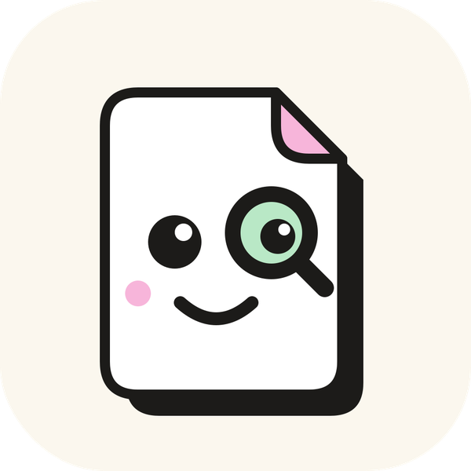
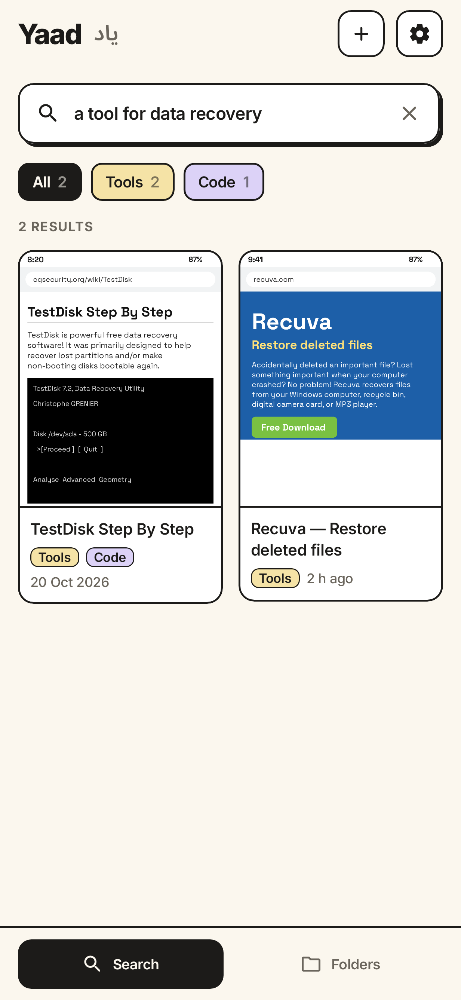
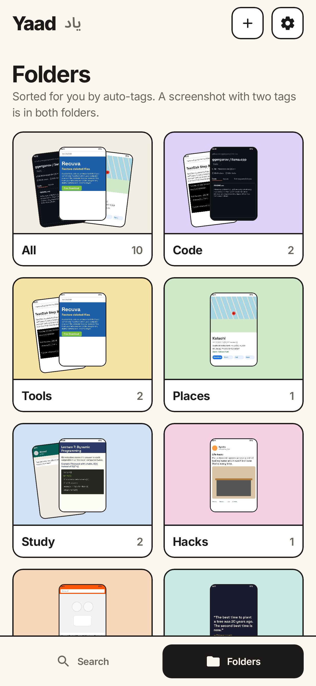
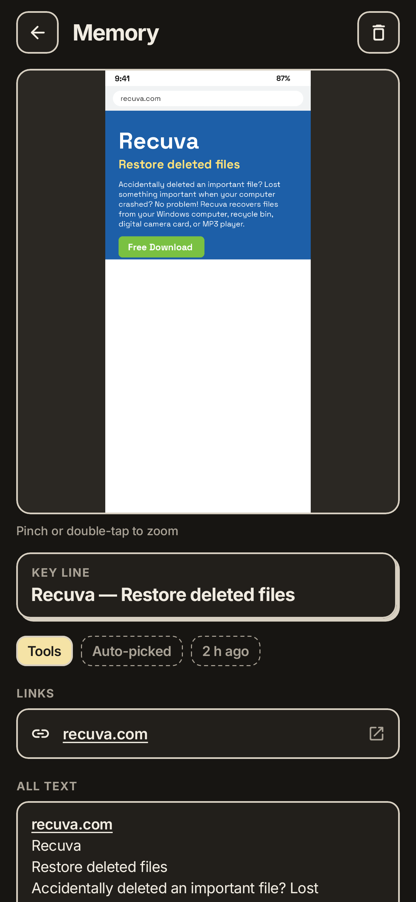
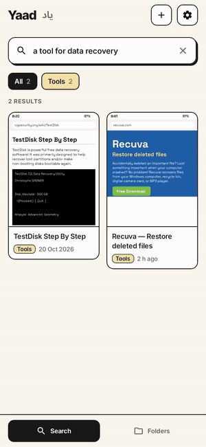
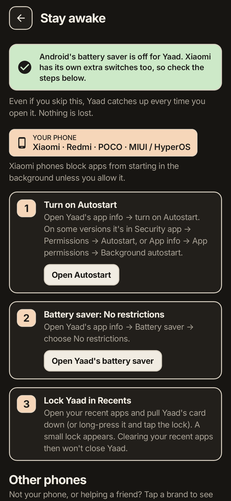

<p align="center">
  
</p>

<h1 align="center">Yaad · یاد</h1>
<p align="center"><b>Never lose a screenshot again.</b></p>
<p align="center">
  <a href="LICENSE"></a>
  <a href="app/build.gradle.kts"></a>
  <a href="#privacy"></a>
  <a href="https://github.com/mr-ans-2006/yaad/releases/latest"></a>
</p>

<p align="center">
  
  
  
</p>

Yaad (یاد, "memory") is an open-source Android app that remembers your screenshots for you.
It reads the text in every screenshot, tags it, and lets you search by **meaning**: type
*"a tool for data recovery"* and it finds the screenshot that said *"Restore deleted files"*.

Everything happens on your phone. No account, no server, and **no internet permission at all**.


<p align="center">
  
</p>

<sub>These images are rendered from the app's real screen code on a computer (with Roborazzi),
using sample screenshots as the gallery content. The animation is drawn frame by frame the same way,
not recorded on a phone.</sub>

## Why I built this

I take screenshots of everything — notes, links, receipts, code, bits of chats. They pile up, I can never find the one I need, and the gallery can't read them. The tools that can mostly upload them to a server. For receipts and chats, I didn't want that. So I built Yaad: read the text on the phone, search by what I remember about it.

I'm a CS student in Karachi, and Yaad is my attempt at fixing this for myself.

## What it does

- **Two tabs.** **Search** is a clean screen: just the search box and your recent searches, and results
  appear as you type. **Folders** sorts your screenshots by their auto-tags (plus All, Untagged and No text);
  open a folder to see its screenshots in a grid, newest first, grouped by date. A screenshot with two tags
  is in both folders.
- **Auto-pick.** New screenshots are picked up on their own (from `DCIM/Screenshots`, `Pictures/Screenshots`,
  or any folder with "screenshot" in its name). You can also **share any image to Yaad**, or tap **Add**.
- **Reads the text.** Google ML Kit's on-device text reader pulls out the English text.
- **Auto-tags.** Code, Tools, Places, Study, Hacks, Shopping, Quotes and Chats.
- **Key line.** The line that best sums up the screenshot is shown as its summary.
- **Search by meaning.** A small AI model (all-MiniLM-L6-v2, 23 MB) understands what your search *means*,
  and a word match makes sure exact names like "llama.cpp" still win.
- **Open the original.** Pinch to zoom, links inside the screenshot are tappable, and "Open in gallery"
  takes you to the real file.
- **Smooth animations.** Opening a screenshot, the thumbnail grows into the full image, and Back shrinks it
  home. Screens fade and slide gently, list items animate in and out, and cards shrink a touch when pressed.
  With Android's "Remove animations" setting on, screens just swap.
- **Light and dark mode**, in a soft neo-brutalist look: thin outlines, one hard shadow only on the main
  elements, colour only on tags. Every word is in the **Inter** font.

## Architecture

```
  Screenshots
  new one in the gallery (MediaStore observer, WorkManager      Share to Yaad / Add
  content trigger, hourly job, catch-up when the app opens)            │
                     │                                                 │
                     └──────────────► Room DB: new row, PENDING ◄──────┘
                                              │
                                              ▼
                        ML Kit OCR (Latin script, bundled, offline)
                        → lines of text + how tall each line is
                                              │
                                              ▼
            core/  key line · links · embeddings · auto-tags
                   embeddings = all-MiniLM-L6-v2 (int8 ONNX), 384 numbers
                   per chunk of up to 120 words, at most 4 chunks
                                              │
                                              ▼
                        Room DB: text, key line, tags, links, vectors
                        (all rows are kept in memory for searching)
                                              │
  your search ──► MiniLM embedding ───────────┐
                                              ▼
            core/  Hybrid search: meaning score + exact-word bonus
                   → best 100 results
```

**Why hybrid search.** Meaning search alone is bad at exact names. A small English model doesn't
really know what "llama.cpp" or "kolachi" is, so a screenshot that literally says it can lose to one
that is only vaguely similar. So each screenshot's score adds two things (see
[`SearchRanker.kt`](core/src/main/kotlin/io/github/mrans2006/yaad/core/SearchRanker.kt)):

- **Meaning:** cosine similarity between your search and the screenshot (its best-matching chunk), up to 1.
- **Exact words:** + 0.35 × the share of your search words found in the text (common words like
  "the" or "find" are skipped; "llama.cpp", "c++" and "c#" stay whole), + 0.15 if your whole search
  appears as written, + 0.10 if a word is one of the screenshot's tags.

A screenshot with a meaning score under 0.27 is only shown if at least one word or tag matches.

**Why `core/` and `app/`.** `core/` is plain Kotlin with no Android dependency, so the search, tagging and
key-line logic is unit-tested on a normal computer's JVM in seconds, without a phone or emulator.

## Privacy

- **No internet permission.** Android itself blocks Yaad from going online. You can check this yourself:
  the only permission Yaad ever asks you for is Photos, and the APK's full permission list is below.
- **Nothing leaves the phone.** Text reading, tagging and search all run on the device.
- **No account, no server, no analytics, no ads.**
- **Only screenshots.** Yaad asks for photo access but only looks at folders named "screenshot".
  Images you share to Yaad are copied into its private storage.
- **Deleting is easy.** Removing a screenshot in Yaad doesn't touch your gallery, and Yaad forgets
  screenshots you delete from the gallery.

One honest note: the text reader (Google ML Kit) is free but not open source. It is bundled in the app,
works offline, and the internet permission its analytics helper asks for is removed. Everything else is open.
See [THIRD_PARTY_NOTICES.md](THIRD_PARTY_NOTICES.md).

**Permissions in the release APK** (from `aapt dump permissions`):

| Permission | Why |
|---|---|
| `READ_MEDIA_IMAGES` (Android 13+) / `READ_EXTERNAL_STORAGE` (Android 12 and older) | To see your screenshots |
| `WAKE_LOCK`, `RECEIVE_BOOT_COMPLETED` | Added by Android's WorkManager so background checks keep working after a restart |
| `…DYNAMIC_RECEIVER_NOT_EXPORTED_PERMISSION` | An internal AndroidX safety permission, private to Yaad |

## Install

1. Download [**Yaad-v1.1.apk**](https://github.com/mr-ans-2006/yaad/releases/download/v1.1/Yaad-v1.1.apk) (31 MB) from the [v1.1 release](https://github.com/mr-ans-2006/yaad/releases/tag/v1.1).
   Already have v1.0? v1.1 installs over it and keeps your library (same signing key).
2. Open it on your phone. Android will ask to allow installing from this source: allow it.
3. Open Yaad, tap **Let's go**, allow photo access, and choose **Import all** or **Only new ones**.
4. Follow the in-app **Battery guide** (Settings → Battery guide) so auto-pick keeps working while
   Yaad is closed. It shows the steps for your phone's brand first. Even without it, Yaad catches up
   every time you open it.

Needs Android 8.0 or newer on a 64-bit (arm64) phone, which covers almost every phone from the last 6 years.
The release APK is about 31 MB, mostly the text reader and the search model.

## Battery guide (keeping auto-pick awake)

Many phone makers add their own battery savers that close apps in the background, so a new screenshot
may wait until you open Yaad. The in-app **Battery guide** fixes that. Yaad reads your phone's maker
name and shows **your phone's steps first**, with every other brand under **Other phones**.

| Phones | System | What the guide walks you through |
|---|---|---|
| Samsung | One UI | Battery → Unrestricted, take Yaad out of Sleeping / Deep sleeping apps, add it to Never sleeping apps |
| Xiaomi · Redmi · POCO | MIUI / HyperOS | Autostart on, Battery saver → No restrictions, lock in Recents |
| Vivo · iQOO | Funtouch OS / OriginOS | Auto-start on, allow background power use, lock in Recents |
| Infinix · Tecno · itel | XOS / HiOS | Phone Master → Auto-start management (Launch manager), app power saving off, lock in Recents |
| Oppo · Realme · OnePlus | ColorOS / OxygenOS | Allow background activity, Auto launch on, lock in Recents |
| Pixel & other phones | Android | Battery → Unrestricted, don't pause when unused |

The buttons try to open the exact settings page for your brand. Phone makers move these pages between
versions, so if one isn't there Yaad opens the closest standard Android page instead (battery
optimisation or Yaad's app info). It never crashes. Yaad does **not** ask for the special
"ignore battery optimisations" permission; you stay in control of the switch.

<p align="center">
  
</p>

Phone not listed, or still stopping? [dontkillmyapp.com](https://dontkillmyapp.com) has detailed steps
for almost every phone. Yaad's guides are based on it.

## How it works (plain English)

1. **Noticing.** Android keeps a list of every photo (the "MediaStore"). Yaad watches that list.
   When something changes, it asks: *any new pictures in a Screenshots folder?*
2. **Reading.** Each new screenshot goes through ML Kit, which finds every line of text and how big it is.
3. **Understanding.** Yaad picks the **key line** (big text, a good length, not the clock or a "Reply" button),
   finds **links**, and turns the text into a list of 384 numbers called an **embedding**. Texts with similar
   meaning get similar numbers. Tags come from keywords plus how close the meaning is to each tag's examples.
4. **Saving.** Everything goes into a small database on the phone.
5. **Searching.** Your search is turned into numbers the same way. Yaad compares it with every screenshot
   (that takes milliseconds) and adds a bonus for exact word matches. Best matches come first.

The full beginner tour of the code is in [docs/HOW_IT_WORKS.md](docs/HOW_IT_WORKS.md).

## Benchmarks

Search time for one query (*"how to run llama.cpp on android"*), median of 20 runs after 10 warm-ups:

| Screenshots | Search (ranking) | Query embedding + search |
|---:|---:|---:|
| ~500 | 17 ms | 20 ms |
| ~1,000 | 30 ms | 33 ms |
| ~2,000 | 66 ms | 68 ms |

**Measured on a desktop JVM (Intel Xeon @ 2.60 GHz, OpenJDK 17), not a phone.** A phone will be slower.
The test screenshots are generated: realistic text lengths (10 to 400 words) and random 384-number vectors,
which cost the same to compare as real ones. Turning the query into a vector with the real model takes
about 2 ms of that. Not included: loading the rows from the database (only on the first search after
something changes) and drawing the results.

Run it yourself with `./gradlew :core:benchmark` (code in
[`SearchBenchmark.kt`](core/src/test/kotlin/io/github/mrans2006/yaad/core/SearchBenchmark.kt)).

## Known limitations

- **English only.** English text is read reliably. Urdu/Sindhi script is not read — those screenshots are saved
  with no text ("No text found", or at most a few stray Latin characters), stay in your library, and cannot be searched.
  Yaad doesn't warn you when this happens. Roman Urdu written in English letters works, including exact-word
  search. Urdu-script search does not work: the model sees only single Urdu letters. (Text is read with ML Kit's
  Latin-script recognizer, and the search model is English.)
- **Tested on one real phone so far** (the maintainer's Oppo Reno 6). Everything else is automated
  tests and screens rendered on a computer. Other phones may behave differently; reports are welcome.
- **Battery guide buttons** open each brand's known settings page, but these move between OS versions,
  so a button may land on a general settings page. The written steps still apply.
- **arm64 only.** The APK has no 32-bit or x86 build, so older 32-bit-only phones can't install it.
- **ML Kit is closed source.** It runs offline, but it means Yaad can't be on F-Droid yet.
- **No backup or export yet.** Android backup is turned off for Yaad, so a new phone or a reinstall
  starts a fresh library. Your screenshots stay in the gallery and can be imported again, but images
  shared into Yaad are lost.

## Build it yourself

You need JDK 17 and the Android SDK (Android Studio includes both).

```bash
git clone https://github.com/mr-ans-2006/yaad.git
cd yaad
./gradlew assembleDebug          # app/build/outputs/apk/debug/app-debug.apk
./gradlew :core:test             # tokenizer, search model, ranking, tags, key line
./gradlew :app:testDebugUnitTest # auto-pick logic against a pretend gallery
./gradlew :app:recordRoborazziDebug   # re-draw every screen to app/build/screenshots-v1.1
./gradlew :core:benchmark        # search speed at 500 / 1,000 / 2,000 screenshots
```

A signed release build needs your own signing key. See [docs/MAINTAINING.md](docs/MAINTAINING.md).

## Project layout

```
core/   Plain Kotlin "brain": tokenizer, embeddings, search ranking, tags, key line. Tested on a computer.
app/    The Android app: screens (Jetpack Compose), database (Room), auto-pick (WorkManager), ML Kit.
docs/   How it works, how to maintain it, ideas for v2, and screenshots.
```

## Roadmap

v1 is English screenshots, saving and searching. Ideas for v2 (real AI summaries, more languages,
collections, backup) are in [docs/V2_IDEAS.md](docs/V2_IDEAS.md).

## License

MIT © 2026 Ali Nawaz. Fonts: Inter and Noto Sans Arabic (SIL Open Font License).
Search model: all-MiniLM-L6-v2 (Apache 2.0). Details in [THIRD_PARTY_NOTICES.md](THIRD_PARTY_NOTICES.md).
