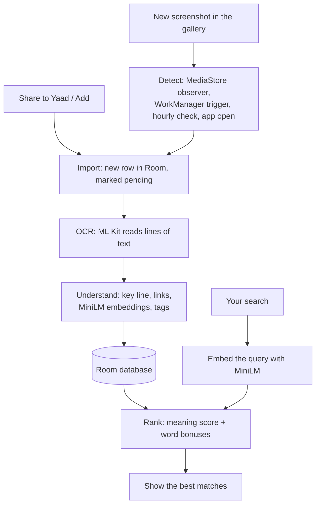

<p align="center">
  
</p>

<h1 align="center">Yaad (یاد)</h1>
<p align="center"><b>Save Now. Find Anytime.</b></p>

<p align="center">
An offline-first Android app that automatically organizes your screenshots and makes their content searchable through on-device OCR and semantic search.
</p>

<p align="center">
  <a href="LICENSE"></a>
  
  <a href="app/build.gradle.kts"></a>
  
  <a href="https://github.com/mr-ans-2006/yaad/releases/latest"></a>
</p>

Yaad (یاد) means "memory" in Urdu. It reads the text in your screenshots, sorts them into folders,
and lets you search by **meaning**. Type *"a tool for data recovery"* and it finds the screenshot
that said *"Restore deleted files"*.

Reading, tagging and search all run on your phone. There is no account, no server, and the app has
**no internet permission**.

**Contents:** [Screenshots](#screenshots) · [Download](#download--installation) · [Features](#features) ·
[Privacy](#privacy--offline-architecture) · [Compatibility](#device-compatibility--testing) ·
[Limitations](#known-limitations) · [For developers](#technology-stack) · [Contributing](#contributing) ·
[License](#license--acknowledgements)

## Screenshots

<p align="center">
  
  
  
</p>
<p align="center">
  <sub><b>Search by meaning</b> &nbsp;·&nbsp; <b>Folders by tag</b> &nbsp;·&nbsp; <b>Key line, tags and links</b> (dark mode)</sub>
</p>

<p align="center">
  
  <br />
  <sub>Opening a screenshot and browsing folders</sub>
</p>

<sub>These images come from the app's real screen code, drawn on a computer with Roborazzi and filled with
sample screenshots. They are not mockups, but they were not captured on a phone either.</sub>

## Download & Installation

Get the latest APK from the **[Releases page](https://github.com/mr-ans-2006/yaad/releases)**.
The current version is **v1.1**: [Yaad-v1.1.apk](https://github.com/mr-ans-2006/yaad/releases/download/v1.1/Yaad-v1.1.apk) (about 31 MB).

1. **Download** the APK on your Android phone.
2. **Open** the downloaded file.
3. **Allow** installing from this source if Android asks. Android may warn you because the app is not from the Play Store.
4. **Open Yaad**, tap **Let's go**, allow photo access, then choose **Import all** or **Only new ones**.

**Requirements**

- Android 8.0 (API 26) or newer. This is the app's `minSdk`, not a promise that every phone works (see [Compatibility](#device-compatibility--testing)).
- A 64-bit **arm64** phone. The APK contains only `arm64-v8a` native code, so 32-bit and x86 devices can't install it.

Already on v1.0? v1.1 installs over it and keeps your library (both releases are signed with the same key).

## Why Yaad?

Screenshots are a quick way to save notes, links, code, receipts and bits of chats. But they pile up,
the gallery can't read them, and finding the one you need means scrolling for minutes.

Many tools that can read screenshots upload them to a server. For receipts and chats, that isn't
always what you want. Yaad reads the text on the phone and lets you search by what you remember.

I'm a CS student in Karachi, and I built Yaad to fix this for myself.

## Features

**Automatic screenshot detection**
New screenshots are picked up on their own from any folder with "screenshot" in its name
(for example `DCIM/Screenshots` or `Pictures/Screenshots`). Yaad listens for gallery changes while it is
running, asks Android to wake it when the gallery changes, checks once an hour, and catches up every time
you open it. You can also **share any image** to Yaad or tap **Add** to pick one.
*Why it helps:* you never have to remember to "save" anything.

**On-device text reading (OCR)**
Google ML Kit's text recognizer, bundled inside the app, reads the text in each screenshot.
*Why it helps:* the text becomes searchable, and the image never leaves your phone.

**Search by meaning**
A small AI model (all-MiniLM-L6-v2, run with ONNX Runtime) understands what your search *means*,
and an exact-word check makes sure names like "llama.cpp" still win. Results appear as you type, and
recent searches are kept on the Search tab. *Why it helps:* you don't need to remember the exact words.

**Smart tags and Folders**
Each screenshot gets up to three tags: **Code, Tools, Places, Study, Hacks, Shopping, Quotes** and **Chats**.
The Folders tab has one folder per tag, plus **All**, **Untagged** (text was read but no tag fitted) and
**No text** (nothing readable was found). A screenshot with two tags appears in both folders.
*Why it helps:* you can browse by topic, not only by date.

**Key line**
For each screenshot, Yaad picks the one line that best sums it up and shows it as its summary. It prefers
large text of a sensible length and skips things like the clock or "Reply" buttons. This is a scoring rule,
not an AI-written summary. *Why it helps:* you can scan a list without opening every image.

**Open the original**
Pinch or double-tap to zoom, tap links found in the text, and use **Open in gallery** to reach the real file.
Removing a screenshot from Yaad leaves it in your gallery.

**Offline-first**
Detection, OCR, tagging, key lines and search all work with no connection. The OCR model and the
search model are files inside the APK, so there is nothing to download after install.

**Light and dark mode**, set to follow the system or chosen in Settings.

<details>
<summary><b>How semantic search works</b> (for the curious)</summary>

<br />

**1. Text becomes numbers.** The search model turns a piece of text into an **embedding**: a list of
384 numbers that describes what it means. Texts with similar meaning get similar lists. Each screenshot's
text is split into chunks of up to 120 words (at most 4 chunks), and each chunk gets its own embedding.

**2. Your search becomes numbers too.** The same model turns your query into one embedding.

**3. Meaning score.** Yaad compares your query with each chunk using **cosine similarity**
(1 means "same meaning", 0 means "unrelated") and keeps the best chunk's score.

**4. Word bonuses.** A small model doesn't know every name, so exact words also count:

| Signal | Bonus |
|---|---|
| Share of your search words found in the text (common words like "the" or "find" are skipped; a word matches at the start of a word, so "recov" finds "recovery") | up to **+0.35** |
| Your whole search appears in the text as written (4+ characters) | **+0.15** |
| One of your words is a tag name, like "code" or "places" | **+0.10** |

**5. Ranking and threshold.** Final score = meaning score + bonuses. Results are sorted by score and the
best **100** are shown. A screenshot with a meaning score under **0.27** is only shown if at least one
word or tag matches, which keeps unrelated results out.

Tags use a similar idea: each matching keyword adds 0.12 (up to 0.48), plus how close the screenshot's
meaning is to a few example sentences for the tag. A tag is given if its score reaches 0.35 and is
close to the best tag's score.

The code is in [`SearchRanker.kt`](core/src/main/kotlin/io/github/mrans2006/yaad/core/SearchRanker.kt) and
[`AutoTagger.kt`](core/src/main/kotlin/io/github/mrans2006/yaad/core/AutoTagger.kt).

</details>

## Privacy & Offline Architecture

**What is implemented**

- **No internet permission.** The manifest removes the `INTERNET` and `ACCESS_NETWORK_STATE` permissions
  that an ML Kit helper library would otherwise add. Without `INTERNET`, Android does not let the app open
  network connections, so Yaad cannot upload your screenshots or their text.
- **Processing happens on the phone.** OCR (ML Kit, bundled model), embeddings (MiniLM on ONNX Runtime),
  tagging, key lines and search all run locally.
- **Where data is stored.** The extracted text, key lines, tags, links and embeddings are saved in a Room
  (SQLite) database, `yaad.db`, in the app's private storage. Images you share into Yaad are copied into
  the app's private storage too. Screenshots picked from the gallery stay where they are; Yaad stores a
  reference to them. Recent searches are kept in the app's private settings.
- **No account, no analytics, no ads.**
- **Only screenshot folders.** Yaad asks for photo access but only queries folders with "screenshot" in the name.
- **Android backup is turned off** (`allowBackup="false"`), so your library is not copied to a cloud backup.
- **Deleting.** Removing a screenshot in Yaad doesn't touch your gallery, and Yaad forgets screenshots you
  delete from the gallery.

**What is not implemented**

- The database is **not encrypted** by Yaad. It relies on Android's normal app sandbox.
- There is **no app lock** (PIN or fingerprint).
- ML Kit is free to use but **closed source**. It runs offline and its network permission is removed,
  but not every part of the app can be inspected.

**Permissions in the v1.1 release APK** (checked with `aapt dump permissions`):

| Permission | Why |
|---|---|
| `READ_MEDIA_IMAGES` (Android 13+) / `READ_EXTERNAL_STORAGE` (Android 12 and older) | To see your screenshots |
| `WAKE_LOCK`, `RECEIVE_BOOT_COMPLETED` | Added by WorkManager so background checks keep working after a restart |
| `…DYNAMIC_RECEIVER_NOT_EXPORTED_PERMISSION` | An internal AndroidX safety permission, private to Yaad |

## Device Compatibility & Testing

| Device | Android version | Testing result |
|---|---|---|
| Oppo Reno 6 | Android 13 | Works (tested by the developer) |

Timing measurements from real devices will be added later.

**Other devices are untested.** Android 8.0 is the minimum version the app is built for, which is not the
same as a tested compatibility claim. If you try Yaad on another phone, please
[report how it went](https://github.com/mr-ans-2006/yaad/issues).

Beyond the device above, the project has automated tests: unit tests for the search, tagging and key-line
logic (`core/`), and tests that run the auto-pick logic and draw every screen on a computer (`app/`).

**Battery restrictions.** Many phone makers add battery savers that stop apps in the background, so a new
screenshot may only appear when you next open Yaad (it always catches up then). While Android's battery
optimisation is still on for Yaad, the Search tab shows a **"Keep Yaad working"** tip, and
**Settings → Battery guide** shows the steps for your phone's brand first.

<details>
<summary><b>Battery guide steps by phone brand</b></summary>

<br />

| Phones | System | What the guide walks you through |
|---|---|---|
| Samsung | One UI | Battery → Unrestricted, take Yaad out of Sleeping / Deep sleeping apps, add it to Never sleeping apps |
| Xiaomi · Redmi · POCO | MIUI / HyperOS | Autostart on, Battery saver → No restrictions, lock in Recents |
| Vivo · iQOO | Funtouch OS / OriginOS | Auto-start on, allow background power use, lock in Recents |
| Infinix · Tecno · itel | XOS / HiOS | Phone Master → Auto-start management, app power saving off, lock in Recents |
| Oppo · Realme · OnePlus | ColorOS / OxygenOS | Allow background activity, Auto launch on, lock in Recents |
| Pixel & other phones | Android | Battery → Unrestricted, don't pause when unused |

The buttons try to open the exact settings page for your brand. Phone makers move these pages between
versions, so if one isn't there, Yaad opens the closest standard Android page instead. Yaad does **not**
ask for the special "ignore battery optimisations" permission. The guides are based on
[dontkillmyapp.com](https://dontkillmyapp.com), which covers almost every phone.

<p align="center">
  
</p>

</details>

## Known Limitations

- **English-only text reading.** Yaad uses ML Kit's Latin-script reader and an English search model.
  Urdu and Sindhi script is not read: those screenshots are saved with no text, appear in the **No text**
  folder and can't be searched. Yaad doesn't warn you when this happens. Roman Urdu written in English
  letters works.
- **arm64 only.** No 32-bit or x86 build.
- **No cloud sync.** Your library lives on one phone.
- **No backup, restore or export.** A new phone or a reinstall starts a fresh library. Gallery screenshots
  can be imported again, but images shared into Yaad are lost.
- **Background detection can be delayed** by battery savers (see above).
- **Battery guide buttons** may land on a general settings page on some OS versions. The written steps still apply.
- **ML Kit is closed source**, so Yaad can't be listed on F-Droid yet.

Ideas for future versions (more languages, backup, AI summaries) are in [docs/V2_IDEAS.md](docs/V2_IDEAS.md).
None of them are implemented yet.

## Technology Stack

<details>
<summary><b>What Yaad is built with</b></summary>

<br />

| Technology | Role in Yaad |
|---|---|
| **Kotlin** | The language for the whole app |
| **Jetpack Compose** (Material 3, Navigation) | Draws every screen and the animations |
| **Room** | The on-phone database for text, tags and embeddings |
| **WorkManager** | Runs the background "look for new screenshots" jobs |
| **MediaStore** | Android's photo index, used to find screenshots |
| **Google ML Kit Text Recognition** (bundled) | Reads text from screenshots, offline |
| **all-MiniLM-L6-v2** (int8 ONNX) | The small model that turns text into embeddings |
| **ONNX Runtime** | Runs the search model on the phone |
| **Coil** | Loads thumbnails |
| **Gradle** (Kotlin DSL, wrapper 8.9) | Builds the app |
| **JUnit, Robolectric, Roborazzi** | Tests, and drawing the screens on a computer |

</details>

## Architecture Overview

<details>
<summary><b>How the pieces fit together</b></summary>

<br />



The project has two modules:

```
core/   Plain Kotlin: tokenizer, embeddings, search ranking, tags, key line. No Android code.
app/    The Android app: screens (Compose), database (Room), auto-pick (WorkManager), ML Kit.
docs/   How it works, how to maintain it, ideas for v2, and screenshots.
```

Because `core/` has no Android code, the search, tagging and key-line logic is tested on a normal
computer without a phone or emulator. For search, the rows are kept in memory and every screenshot is
compared with the query directly.

A beginner's tour of the code is in [docs/HOW_IT_WORKS.md](docs/HOW_IT_WORKS.md).

</details>

## Build from Source

<details>
<summary><b>Build and test commands</b></summary>

<br />

**Requirements:** JDK 17 and the Android SDK (platform 35). Android Studio includes both. Gradle is
downloaded by the included wrapper.

```bash
git clone https://github.com/mr-ans-2006/yaad.git
cd yaad
./gradlew :core:test               # tokenizer, search model, ranking, tags, key line
./gradlew :app:testDebugUnitTest   # auto-pick logic and screen rendering
./gradlew assembleDebug            # builds the debug APK
```

The debug APK is written to `app/build/outputs/apk/debug/app-debug.apk`.

Other useful tasks:

```bash
./gradlew :app:recordRoborazziDebug   # re-draw every screen to PNG images
./gradlew :core:benchmark             # search speed test (runs on your computer)
```

A signed release build needs your own signing key. See [docs/MAINTAINING.md](docs/MAINTAINING.md).

</details>

## Contributing

Contributions are welcome, from code to docs to testing.

1. **Fork** the repository.
2. **Create a branch:** `git checkout -b my-change`
3. **Make your change.**
4. **Test it:** run `./gradlew :core:test :app:testDebugUnitTest`, and try the app if you can.
5. **Open a pull request** that explains what you changed and why.

Other ways to help:

- **Report a bug:** [open an issue](https://github.com/mr-ans-2006/yaad/issues) with your phone model, Android version, Yaad version and the steps to reproduce it.
- **Suggest a feature:** open an issue describing the problem it solves.
- **Improve the docs:** fixes to this README or [docs/](docs/) are very welcome.
- **Help test:** try Yaad on your phone and report the result, especially on brands other than Oppo.

> **Please don't upload private screenshots or personal data in issues.** Screenshots often contain
> chats, receipts, addresses or passwords. Crop them, blur private parts, or describe the text instead.

## Feedback & Community

Have you tried Yaad? Your feedback helps shape the next version.

- **Search accuracy:** did a search miss a screenshot you expected, or show an unrelated one? Tell me
  the query and roughly what the screenshot said (not the screenshot itself).
- **Bugs and ideas:** use [GitHub Issues](https://github.com/mr-ans-2006/yaad/issues).
- **Your experience:** what you use Yaad for, and which phone you use it on.

## License & Acknowledgements

Yaad's own code is released under the **[MIT License](LICENSE)**, © 2026 Ali Nawaz.

Yaad is built with these projects, which keep their own licenses:

- **[Google ML Kit Text Recognition](https://developers.google.com/ml-kit/vision/text-recognition/v2/android)** for reading text (free under Google's ML Kit terms, not open source)
- **[all-MiniLM-L6-v2](https://huggingface.co/sentence-transformers/all-MiniLM-L6-v2)** by sentence-transformers for search (Apache License 2.0)
- **[ONNX Runtime](https://github.com/microsoft/onnxruntime)** by Microsoft for running the model (MIT)
- **[Inter](https://github.com/rsms/inter)** font by Rasmus Andersson and **[Noto Sans Arabic](https://github.com/notofonts/arabic)** for the یاد wordmark (SIL Open Font License 1.1)
- **Jetpack Compose, Room, WorkManager** and other AndroidX libraries, and **[Coil](https://github.com/coil-kt/coil)** (Apache License 2.0)
- **[dontkillmyapp.com](https://dontkillmyapp.com)**, the basis for the battery guides

Full details are in [THIRD_PARTY_NOTICES.md](THIRD_PARTY_NOTICES.md).
