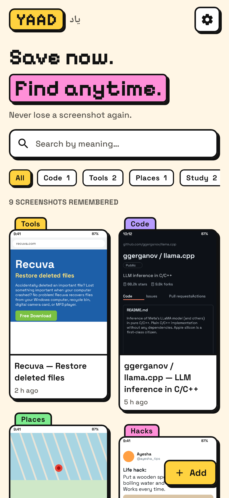
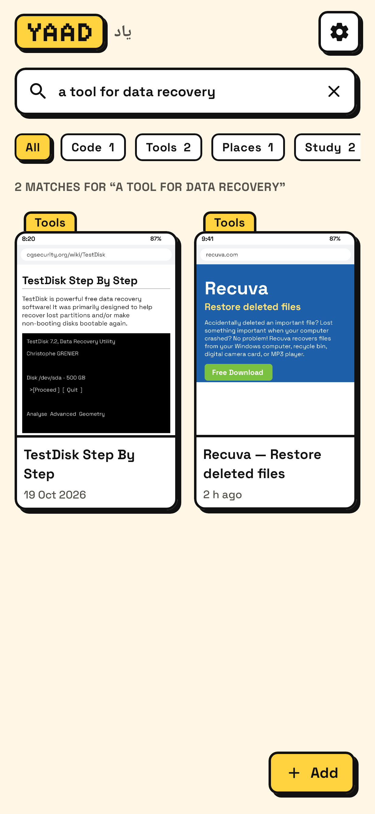
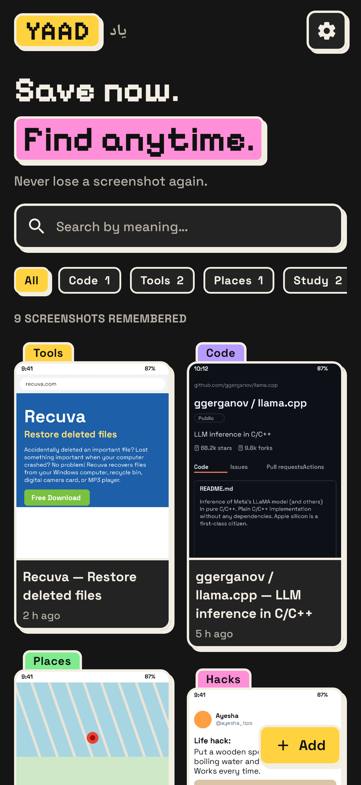
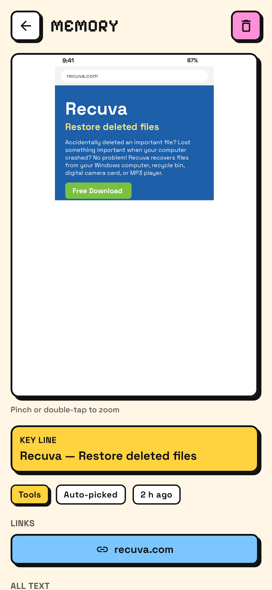
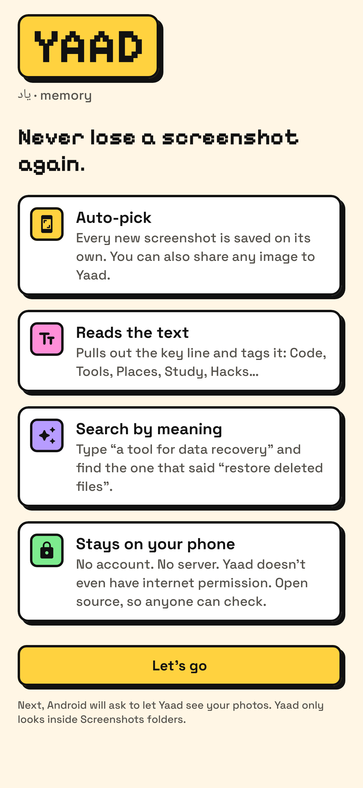
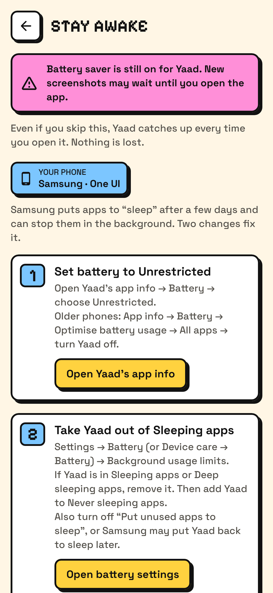
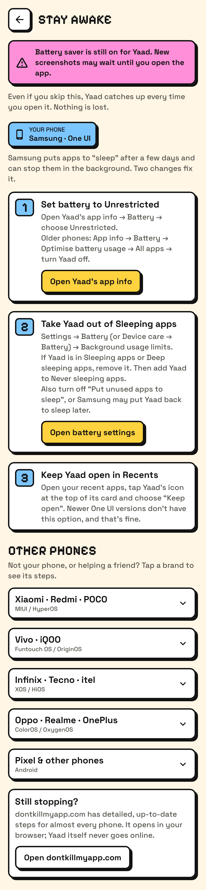
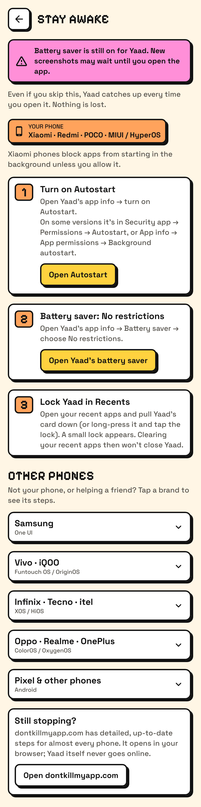
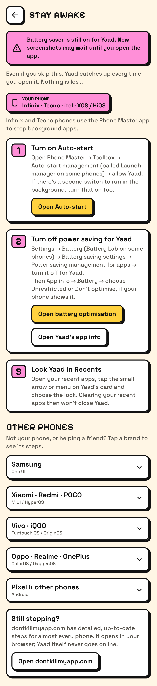

<p align="center">
  
</p>

<h1 align="center">Yaad · یاد</h1>
<p align="center"><b>Never lose a screenshot again.</b></p>

Yaad (یاد, "memory") is an open-source Android app that remembers your screenshots for you.
It reads the text in every screenshot, tags it, and lets you search by **meaning**: type
*"a tool for data recovery"* and it finds the screenshot that said *"Restore deleted files"*.

Everything happens on your phone. No account, no server, and **no internet permission at all**.

<p align="center">
  
  
  
</p>
<p align="center">
  
  
  
</p>

<sub>These images are rendered from the app's real screen code on a computer (with Roborazzi),
using sample screenshots as the gallery content.</sub>

## What it does

- **Auto-pick.** New screenshots are picked up on their own (from `DCIM/Screenshots`, `Pictures/Screenshots`,
  or any folder with "screenshot" in its name). You can also **share any image to Yaad**, or tap **Add**.
- **Reads the text.** Google ML Kit's on-device text reader pulls out the English text.
- **Auto-tags.** Code, Tools, Places, Study, Hacks, Shopping, Quotes and Chats.
- **Key line.** The line that best sums up the screenshot is shown as its summary.
- **Search by meaning.** A small AI model (all-MiniLM-L6-v2, 23 MB) understands what your search *means*,
  and a word match makes sure exact names like "llama.cpp" still win.
- **Open the original.** Pinch to zoom, links inside the screenshot are tappable, and "Open in gallery"
  takes you to the real file.
- **Light and dark mode**, in a neo-brutalist look: thick outlines, hard shadows, flat bright colours.

## Privacy

- **No internet permission.** Android itself blocks Yaad from going online. You can check this yourself:
  the only permission Yaad ever asks you for is Photos, and the APK's full permission list is below.
- **Nothing leaves the phone.** Text reading, tagging and search all run on the device.
- **No account, no server, no analytics, no ads.**
- **Only screenshots.** Yaad asks for photo access but only looks at folders named "screenshot".
  Images you share to Yaad are copied into its private storage.
- **Deleting is easy.** Removing a screenshot in Yaad doesn't touch your gallery, and Yaad forgets
  screenshots you delete from the gallery.

One honest note: the text reader (Google ML Kit) is free but not open source. It is bundled in the app,
works offline, and the internet permission its analytics helper asks for is removed. Everything else is open.
See [THIRD_PARTY_NOTICES.md](THIRD_PARTY_NOTICES.md).

**Permissions in the release APK** (from `aapt dump permissions`):

| Permission | Why |
|---|---|
| `READ_MEDIA_IMAGES` (Android 13+) / `READ_EXTERNAL_STORAGE` (Android 12 and older) | To see your screenshots |
| `WAKE_LOCK`, `RECEIVE_BOOT_COMPLETED` | Added by Android's WorkManager so background checks keep working after a restart |
| `…DYNAMIC_RECEIVER_NOT_EXPORTED_PERMISSION` | An internal AndroidX safety permission, private to Yaad |

## Install

1. Download `Yaad-v1.0.apk` (from the Releases page).
2. Open it on your phone. Android will ask to allow installing from this source: allow it.
3. Open Yaad, tap **Let's go**, allow photo access, and choose **Import all** or **Only new ones**.
4. Follow the in-app **Battery guide** (Settings → Battery guide) so auto-pick keeps working while
   Yaad is closed. It shows the steps for your phone's brand first. Even without it, Yaad catches up
   every time you open it.

Needs Android 8.0 or newer on a 64-bit (arm64) phone, which covers almost every phone from the last 6 years.
The release APK is about 32 MB, mostly the text reader and the search model.

## Battery guide (keeping auto-pick awake)

Many phone makers add their own battery savers that close apps in the background, so a new screenshot
may wait until you open Yaad. The in-app **Battery guide** fixes that. Yaad reads your phone's maker
name and shows **your phone's steps first**, with every other brand under **Other phones**.

| Phones | System | What the guide walks you through |
|---|---|---|
| Samsung | One UI | Battery → Unrestricted, take Yaad out of Sleeping / Deep sleeping apps, add it to Never sleeping apps |
| Xiaomi · Redmi · POCO | MIUI / HyperOS | Autostart on, Battery saver → No restrictions, lock in Recents |
| Vivo · iQOO | Funtouch OS / OriginOS | Auto-start on, allow background power use, lock in Recents |
| Infinix · Tecno · itel | XOS / HiOS | Phone Master → Auto-start management (Launch manager), app power saving off, lock in Recents |
| Oppo · Realme · OnePlus | ColorOS / OxygenOS | Allow background activity, Auto launch on, lock in Recents |
| Pixel & other phones | Android | Battery → Unrestricted, don't pause when unused |

The buttons try to open the exact settings page for your brand. Phone makers move these pages between
versions, so if one isn't there Yaad opens the closest standard Android page instead (battery
optimisation or Yaad's app info). It never crashes. Yaad does **not** ask for the special
"ignore battery optimisations" permission; you stay in control of the switch.

<p align="center">
  
  
  
</p>

Phone not listed, or still stopping? [dontkillmyapp.com](https://dontkillmyapp.com) has detailed steps
for almost every phone. Yaad's guides are based on it.

## Build it yourself

You need JDK 17 and the Android SDK (Android Studio includes both).

```bash
git clone https://github.com/mr-ans-2006/yaad.git
cd yaad
./gradlew assembleDebug          # app/build/outputs/apk/debug/app-debug.apk
./gradlew :core:test             # tokenizer, search model, ranking, tags, key line
./gradlew :app:testDebugUnitTest # auto-pick logic against a pretend gallery
./gradlew :app:recordRoborazziDebug   # re-draw the screenshots in docs/screenshots
```

A signed release build needs your own signing key. See [docs/MAINTAINING.md](docs/MAINTAINING.md).

## How it works (plain English)

1. **Noticing.** Android keeps a list of every photo (the "MediaStore"). Yaad watches that list.
   When something changes, it asks: *any new pictures in a Screenshots folder?*
2. **Reading.** Each new screenshot goes through ML Kit, which finds every line of text and how big it is.
3. **Understanding.** Yaad picks the **key line** (big text, a good length, not the clock or a "Reply" button),
   finds **links**, and turns the text into a list of 384 numbers called an **embedding**. Texts with similar
   meaning get similar numbers. Tags come from keywords plus how close the meaning is to each tag's examples.
4. **Saving.** Everything goes into a small database on the phone.
5. **Searching.** Your search is turned into numbers the same way. Yaad compares it with every screenshot
   (that takes milliseconds) and adds a bonus for exact word matches. Best matches come first.

The full beginner tour of the code is in [docs/HOW_IT_WORKS.md](docs/HOW_IT_WORKS.md).

## Project layout

```
core/   Plain Kotlin "brain": tokenizer, embeddings, search ranking, tags, key line. Tested on a computer.
app/    The Android app: screens (Jetpack Compose), database (Room), auto-pick (WorkManager), ML Kit.
docs/   How it works, how to maintain it, ideas for v2, and screenshots.
```

## Roadmap

v1 is English screenshots, saving and searching. Ideas for v2 (real AI summaries, more languages,
collections, backup) are in [docs/V2_IDEAS.md](docs/V2_IDEAS.md).

## License

MIT © 2026 Ali Nawaz. Fonts: Pixelify Sans and Space Grotesk (SIL Open Font License).
Search model: all-MiniLM-L6-v2 (Apache 2.0). Details in [THIRD_PARTY_NOTICES.md](THIRD_PARTY_NOTICES.md).
